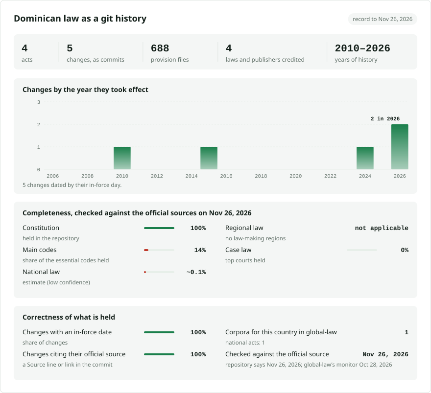

# Dominican Republic: law history in git

[Español](README.md) · **English**

<picture>
<source media="(prefers-color-scheme: dark)" srcset="data/effort-dark.svg">

</picture>

The Constitution, the Código Penal, the Código Procesal Penal, the Código Tributario, Ley 479-08 on companies and Ley 53-07 of the Dominican Republic as a git history: one file per article, one commit per text on the day it took effect, and that text as the commit's author. `git blame` names the text behind every paragraph; `git log` lists every change to an article; picking a date gives the text in force that day.

Part of [lexifina/global-law](https://github.com/lexifina/global-law), one git history for every country's law: this is the Dominican Republic's national law, which global-law reads at `dominican-republic/national/acts/`.

**What is in it now:** the Constitution, in three texts: the one proclaimed on 26 January 2010 and the reformed texts proclaimed on 13 June 2015 and 27 October 2024. In force today: 278 articles, 10 transitory provisions and the final provision. And the Código Penal (Ley 74-25 as modified by Ley 44-26, 393 articles in `codigo-penal/`), in force from 5 August 2026 and its articles 8 to 11 from 5 November 2026, from the unified text the Consultoría published as a special edition of the Gaceta Oficial (no. 11257). Also the Código Tributario (Ley 11-92) in the DGII consolidated text up to Ley 253-12 (in `codigo-tributario/`, in force from 2012) and Ley 53-07 on high-technology crimes (in `leyes/2007/ley-53-07/`, the WIPO Lex copy). Also the Código Procesal Penal (Ley orgánica 97-25, 470 articles in `codigo-procesal-penal/`), in force from 10 December 2025, from the phlaw.com copy of the signed original, whose text is that copy's OCR layer with its recognition errors; and Ley 479-08 on commercial companies and EIRL in the DGII consolidated text up to Ley 31-11 (in `leyes/2008/ley-479-08/`, in force from 2011). No other act is here yet. [`acts.csv`](acts.csv) lists the texts and their PDFs.

Each provision is one file in `constitucion/`, one line per paragraph as printed: `articulo-081.md` is Article 81 (the Chamber of Deputies), `transitoria-01.md` the first transitory provision, `disposicion-final.md` the final provision; `preambulo.md` holds the preamble and `estructura.md` the titles, chapters and sections. The 2024 reform replaced the 20 transitory provisions of 2015 with 10 new ones, so `transitoria-01.md` to `transitoria-10.md` hold different provisions before and after it.

The text is in Spanish, as the Consultoría Jurídica del Poder Ejecutivo publishes it. An English translation is not part of this record.

## Questions as git commands

| Question | Command |
| --- | --- |
| Every change to Article 81 of the Constitution | `git log -p --word-diff -- constitucion/articulo-081.md` |
| Which text wrote each line of Article 81? | `git blame constitucion/articulo-081.md` |
| Every version of the Constitution, with the day each took effect | `git log --format="%h %(trailers:key=In-force,valueonly,separator=) %an" -- constitucion` |
| Article 81 as in force on 1 January 2020 | `python tools/in_force_on.py 2020-01-01 constitucion/articulo-081.md` |

**Outside git**, we also host this record publicly, for free:

- **[Ask Claude about Dominican law](https://global-law.lexifina.com/v1/try_claude?country=dominican-republic)**: opens Claude with a first question ready.
- **[Ask ChatGPT](https://global-law.lexifina.com/v1/try_chatgpt?country=dominican-republic)**: the same question in ChatGPT.
- **[Search Dominican law on our site](https://lexifina.com/law?country=dominican-republic&q=vacaciones)**: a search for "vacaciones", with each provision's text and its versions, no account needed.
- **[Developer REST API](https://global-law.lexifina.com/v1/search_law?query=vacaciones&jurisdiction=dominican-republic)**: the same search as JSON, with no key. See the [documentation here](https://lexifina.com/api/global-law).

Both assistants read the record through the free Global law connector (MCP, `https://global-law.lexifina.com/mcp`); the first time, the chat gives you the link that adds it. Ask in Spanish or in English.

**Host it yourself easily.** All it takes is git and Python, and the tools run on your machine:

```sh
git clone --depth 1 https://github.com/lexifina/global-law && cd global-law
python3 tools/countries.py add dominican-republic/national/acts
python3 tools/law.py show 2026-01-01 dominican-republic/national/acts/constitucion/articulo-081.md
```

Opened in Claude Code, Cursor, VS Code or Codex, the clone also starts a local MCP server with the same tools ([MCP.md](https://github.com/lexifina/global-law/blob/main/MCP.md)).

## Dates

Each commit is dated at noon, America/Santo_Domingo (UTC-4, no summer time since 2000), on the day the text took effect, and carries it in its `In-force:` trailer:

- each text says in its Disposición final that it takes effect on its proclamation ("entrará en vigencia a partir de su proclamación"), so the day is the one its closing "DADA Y PROCLAMADA" paragraph gives, also kept in `Proclaimed:`;
- the 2010 text was printed in Gaceta Oficial n.º 10561 the same day (`Published:`); the 2015 and 2024 PDFs carry no Gaceta number, so none is given;
- `git log --before` compares commit times in your own time zone; ask for a date with `tools/in_force_on.py`, which reads `In-force:`.

Each commit is credited to the proclaimed text (`Reforma constitucional de 2015`), so `git blame` names it. Each reform is the whole text the Asamblea Nacional Revisora proclaimed, so the articles that differ only in spelling, capitalisation, punctuation or agreement (8 in 2015, 6 in 2024) are credited to it too; each commit message lists them apart.

## How it is checked

- `tools/check_repo.py` reads every version of the Constitution back from git and compares it with the official PDF, file by file and byte for byte, and again as letters and digits read by a second, independent PDF reader (pypdf).
- The build stops unless each text's in-force day matches its "DADA Y PROCLAMADA" paragraph, and each reform changes exactly the files read by hand as changed in substance or in wording only.
- `tools/test_repo.py` checks that blame, the dated tool and the citation rule work. The results are in [`REPRODUCE.md`](REPRODUCE.md); the same data gives the same commit hashes.
- History is append-only: no merge commits, and the law commits are in date order.
- [vulnerabilities/](vulnerabilities/README.en.md): possible drafting mistakes in this law, found by global-law's detectors and checked by hand. Not run yet.

## What it does not show

- **Constitutions before 2010** (1844 to 2002). The Consultoría publishes the 2002 text only as an image scan and the older ones as OCR scans, so the record starts with the 2010 text.
- **Any other law or code**: not the Código Civil, the Código de Procedimiento Civil, the Código de Trabajo, the Código de Comercio, the Código Penal of 1884 that Ley 74-25 replaced, nor the Código Procesal Penal of 2002 (Ley 76-02). The Consultoría's legislation search does not answer automated tools; the copies found have no reliable in-force day, are scans with poor OCR or, for the Ministry of Labour's Código de Trabajo, forbid reproduction without permission (see [`SOURCES.md`](SOURCES.md)).
- **The reform laws** (the "ley de declaratoria de necesidad de la reforma"): the changes are read from the proclaimed texts.
- **Rulings of the Tribunal Constitucional**, and laws that change how the Constitution works without changing its words.

## Sources

| Source | Kind | Past versions | Notes |
| --- | --- | --- | --- |
| [Consultoría Jurídica del Poder Ejecutivo](https://www.consultoria.gov.do/consultas/constituciones) | Official texts of the constitutions (publisher of the Gaceta Oficial) | yes, each proclaimed text: 2010, 2015, 2024 | Born-digital PDFs; only the printed Gaceta Oficial is authoritative |
| [Gaceta Oficial no. 11257, special edition (CJPE), the copy the DGII publishes](https://dgii.gov.do/transparencia/CIGCN/Marco%20Legal%20CIGCN/Codigo%20Penal%20de%20la%20Rep%C3%BAblica%20Dominicana%20-%20Consolidado%20con%20modificaciones.pdf) | Official unified text of the Código Penal (Leyes 74-25 and 44-26), certified by the Consultor Jurídico del Poder Ejecutivo | no: only the text in force from 2026 | Born-digital PDF; the edition's footnotes are not copied |
| [DGII: Código Tributario y leyes que lo modifican](https://dgii.gov.do/legislacion/leyesTributarias/Documents/Codigo%20Tributario%20y%20Leyes%20que%20lo%20modifican%20y%20complementan/11-92.pdf) | Consolidated text of the Código Tributario up to Ley 253-12 (secondary copy, not the Gaceta Oficial) | no: one text, in force from 15 November 2012 | Born-digital PDF; does not carry Ley 25-24 |
| [WIPO Lex](https://www.wipo.int/wipolex/es/legislation/details/10198) | Ley 53-07 as enacted (secondary copy) | no | Born-digital PDF |
| [DGII: Ley 479-08](https://dgii.gov.do/legislacion/leyesTributarias/Documents/Otras%20Leyes%20de%20Inter%C3%A9s/479-08.pdf) | Ley 479-08 consolidated up to Ley 31-11 (secondary copy, not the Gaceta Oficial) | no: one text, in force from 12 February 2011 | does not carry the 2019 law that modified article 91 |
| [phlaw.com: Ley 97-25](https://phlaw.com/codigo-procesal-penal-ley-97-25/) | Código Procesal Penal (Ley 97-25), scan of the signed original (secondary copy) | no | the publisher's OCR text, with its errors (`Text-source: publisher OCR`) |

## Licence

See [`LICENSE`](LICENSE). The Consultoría's terms of use (section 4) say the legal texts it publishes are in the public domain. The history, tables and tools are CC0 1.0.

No AI model wrote legal text or runs at build time; the code was written by an AI model, Claude Opus 5.5 in Claude Code (see [`REPRODUCE.md`](REPRODUCE.md)).

## Visualisations

- [visualisations/](visualisations/README.en.md): charts drawn from this repository. Not drawn yet.

## More

From [lexifina/global-law](https://github.com/lexifina/global-law):

- [FEATURES.md](https://github.com/lexifina/global-law/blob/main/FEATURES.md): every feature, and what every corpus must support (`git blame`, `law.py`, the MCP tools)
- [FAQ.md](https://github.com/lexifina/global-law/blob/main/FAQ.md): questions and answers · [CONTRIBUTING.md](https://github.com/lexifina/global-law/blob/main/CONTRIBUTING.md): proposing changes · [MCP.md](https://github.com/lexifina/global-law/blob/main/MCP.md): the MCP server · [REPRODUCE.md](https://github.com/lexifina/global-law/blob/main/REPRODUCE.md): how it was built · [CHANGELOG.md](https://github.com/lexifina/global-law/blob/main/CHANGELOG.md)
- [FRESHNESS.md](https://github.com/lexifina/global-law/blob/main/FRESHNESS.md): how current each corpus is · [Monitoring](https://github.com/lexifina/global-law/tree/main/monitoring): whether updates are running · [WATCHING.md](https://github.com/lexifina/global-law/blob/main/WATCHING.md): how each official source is watched for changes
- [performance/](https://github.com/lexifina/global-law/tree/main/performance): how fast the tools are, measured
- [visualisations/](https://github.com/lexifina/global-law/tree/main/visualisations): charts and bridges across the world's law
- [Vulnerabilities](https://github.com/lexifina/global-law/tree/main/vulnerabilities): mistakes in legislation as published
