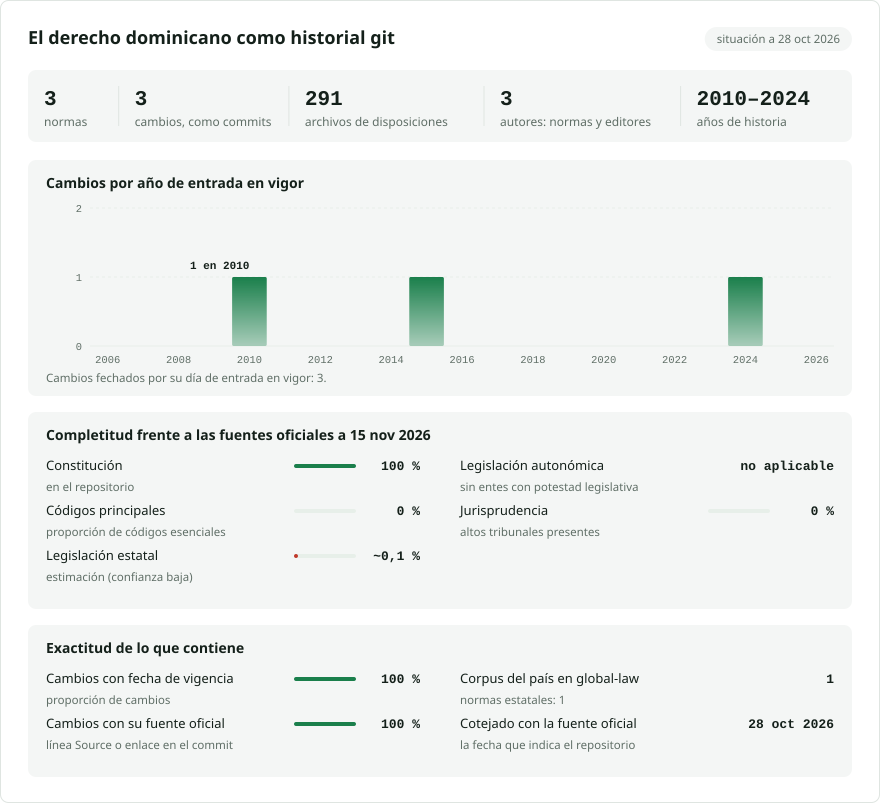

# República Dominicana: historia del derecho en git

**Español** · [English](README.en.md)

<picture>
<source media="(prefers-color-scheme: dark)" srcset="data/es/effort-dark.svg">

</picture>

La Constitución y el Código Penal de la República Dominicana como historia de git: un archivo por artículo, un commit por texto el día en que entró en vigencia, y ese texto como autor del commit. `git blame` indica el texto que está detrás de cada párrafo; `git log` enumera todos los cambios de un artículo; al elegir una fecha se obtiene el texto vigente ese día.

Forma parte de [lexifina/global-law](https://github.com/lexifina/global-law), una única historia de git para el derecho de todos los países: este es el derecho nacional de la República Dominicana, que global-law lee en `dominican-republic/national/acts/`.

**Qué contiene ahora:** la Constitución, en tres textos: el proclamado el 26 de enero de 2010 y los textos reformados proclamados el 13 de junio de 2015 y el 27 de octubre de 2024. Vigentes hoy: 278 artículos, 10 disposiciones transitorias y la disposición final. Y el Código Penal (Ley núm. 74-25 con las modificaciones de la Ley núm. 44-26, 393 artículos en `codigo-penal/`), vigente desde el 5 de agosto de 2026 y sus artículos 8 a 11 desde el 5 de noviembre de 2026, según el texto unificado que la Consultoría publicó como edición especial de la Gaceta Oficial (n.º 11257). Todavía no hay ninguna otra norma. [`acts.csv`](acts.csv) enumera los textos y sus PDF oficiales.

Cada disposición es un archivo en `constitucion/`, una línea por párrafo tal como está impreso: `articulo-081.md` es el Artículo 81 (la Cámara de Diputados), `transitoria-01.md` la primera disposición transitoria, `disposicion-final.md` la disposición final; `preambulo.md` contiene el preámbulo y `estructura.md` los títulos, capítulos y secciones. La reforma de 2024 sustituyó las 20 disposiciones transitorias de 2015 por 10 nuevas, por lo que `transitoria-01.md` a `transitoria-10.md` contienen disposiciones distintas antes y después de ella.

El texto está en español, tal como lo publica la Consultoría Jurídica del Poder Ejecutivo. Este registro no incluye una traducción al inglés.

## Preguntas como comandos de git

| Pregunta | Comando |
| --- | --- |
| Todos los cambios del Artículo 81 de la Constitución | `git log -p --word-diff -- constitucion/articulo-081.md` |
| ¿Qué texto escribió cada línea del Artículo 81? | `git blame constitucion/articulo-081.md` |
| Todas las versiones de la Constitución, con el día en que entró en vigencia cada una | `git log --format="%h %(trailers:key=In-force,valueonly,separator=) %an" -- constitucion` |
| El Artículo 81 vigente al 1 de enero de 2020 | `python tools/in_force_on.py 2020-01-01 constitucion/articulo-081.md` |

**Fuera de git**, también alojamos este registro de forma pública y gratuita:

- **[Preguntar a Claude sobre el derecho dominicano](https://global-law.lexifina.com/v1/try_claude?country=dominican-republic)**: abre Claude con una primera pregunta preparada.
- **[Preguntar a ChatGPT](https://global-law.lexifina.com/v1/try_chatgpt?country=dominican-republic)**: la misma pregunta en ChatGPT.
- **[Buscar en el derecho dominicano en nuestro sitio](https://lexifina.com/law?country=dominican-republic&q=vacaciones)**: una búsqueda de "vacaciones", con el texto de cada disposición y sus versiones, sin necesidad de cuenta.
- **[API REST para desarrolladores](https://global-law.lexifina.com/v1/search_law?query=vacaciones&jurisdiction=dominican-republic)**: la misma búsqueda en JSON, sin clave. Consulte la [documentación aquí](https://lexifina.com/api/global-law).

Ambos asistentes leen el registro a través del conector gratuito Global law (MCP, `https://global-law.lexifina.com/mcp`); la primera vez, el chat le da el enlace para agregarlo. Pregunte en español o en inglés.

**Alójelo usted mismo fácilmente.** Solo hacen falta git y Python, y las herramientas se ejecutan en su equipo:

```sh
git clone --depth 1 https://github.com/lexifina/global-law && cd global-law
python3 tools/countries.py add dominican-republic/national/acts
python3 tools/law.py show 2026-01-01 dominican-republic/national/acts/constitucion/articulo-081.md
```

Abierto en Claude Code, Cursor, VS Code o Codex, el clon también inicia un servidor MCP local con las mismas herramientas ([MCP.md](https://github.com/lexifina/global-law/blob/main/MCP.md)).

## Fechas

Cada commit está fechado a las doce del mediodía, hora de America/Santo_Domingo (UTC-4, sin horario de verano desde 2000), del día en que el texto entró en vigencia, y lleva ese día en su trailer `In-force:`:

- cada texto dice en su Disposición final que entra en vigencia con su proclamación ("entrará en vigencia a partir de su proclamación"), por lo que el día es el que da su párrafo final "DADA Y PROCLAMADA", que también se conserva en `Proclaimed:`;
- el texto de 2010 se publicó en la Gaceta Oficial n.º 10561 el mismo día (`Published:`); los PDF de 2015 y 2024 no indican ningún número de Gaceta, por lo que no se da ninguno;
- `git log --before` compara las horas de los commits en su propia zona horaria; para consultar una fecha, use `tools/in_force_on.py`, que lee `In-force:`.

Cada commit se atribuye al texto proclamado (`Reforma constitucional de 2015`), de modo que `git blame` lo indica. Cada reforma es el texto completo que proclamó la Asamblea Nacional Revisora, por lo que los artículos que solo difieren en ortografía, uso de mayúsculas, puntuación o concordancia (8 en 2015, 6 en 2024) también se le atribuyen; el mensaje de cada commit los enumera por separado.

## Cómo se verifica

- `tools/check_repo.py` vuelve a leer desde git cada versión de la Constitución y la compara con el PDF oficial, archivo por archivo y byte por byte, y de nuevo como letras y dígitos leídos por un segundo lector de PDF independiente (pypdf).
- La compilación se detiene si el día de entrada en vigencia de algún texto no coincide con su párrafo "DADA Y PROCLAMADA", o si alguna reforma no cambia exactamente los archivos que una lectura manual identificó como modificados en el fondo o solo en la redacción.
- `tools/test_repo.py` verifica que funcionan blame, la herramienta de consulta por fecha y la regla de citación. Los resultados están en [`REPRODUCE.md`](REPRODUCE.md); los mismos datos producen los mismos hashes de commit.
- La historia solo admite agregados: no hay commits de fusión (merge), y los commits de las normas están en orden cronológico.
- [vulnerabilities/](vulnerabilities/): posibles errores de redacción en este derecho, hallados por los detectores de global-law y revisados a mano. Aún no se ha ejecutado.

## Qué no muestra

- **Las Constituciones anteriores a 2010** (de 1844 a 2002). La Consultoría publica el texto de 2002 solo como imagen escaneada y los más antiguos como escaneos con OCR, por lo que el registro comienza con el texto de 2010.
- **Ninguna otra ley ni otro código**, ni el Código Penal de 1884 que la Ley núm. 74-25 sustituyó. La base de datos legislativa de la Consultoría contiene las normas solo tal como se promulgaron, sin versiones consolidadas, y su búsqueda no responde a herramientas automáticas. Los textos anteriores al 5 de agosto de 2026 no pueden agregarse después de los commits de 2026 sin romper el orden cronológico de la historia.
- **Las leyes de reforma** (la "ley de declaratoria de necesidad de la reforma"): los cambios se leen de los textos proclamados.
- **Las sentencias del Tribunal Constitucional**, y las leyes que cambian el funcionamiento de la Constitución sin cambiar su texto.

## Fuentes

| Fuente | Tipo | Versiones anteriores | Notas |
| --- | --- | --- | --- |
| [Consultoría Jurídica del Poder Ejecutivo](https://www.consultoria.gov.do/consultas/constituciones) | Textos oficiales de las constituciones (editora de la Gaceta Oficial) | sí, cada texto proclamado: 2010, 2015, 2024 | PDF nativos digitales; solo la Gaceta Oficial impresa es fehaciente |
| [Gaceta Oficial n.º 11257, edición especial (CJPE), copia publicada por la DGII](https://dgii.gov.do/transparencia/CIGCN/Marco%20Legal%20CIGCN/Codigo%20Penal%20de%20la%20Rep%C3%BAblica%20Dominicana%20-%20Consolidado%20con%20modificaciones.pdf) | Texto unificado oficial del Código Penal (Leyes núm. 74-25 y 44-26), certificado por el Consultor Jurídico del Poder Ejecutivo | no: solo el texto vigente desde 2026 | PDF nativo digital; sin las notas al pie de la edición |

## Licencia

Véase [`LICENSE`](LICENSE). Los términos de uso de la Consultoría (sección 4) dicen que los textos jurídicos que publica son de dominio público. La historia, las tablas y las herramientas son CC0 1.0.

Ningún modelo de IA escribió texto normativo ni se ejecuta durante la compilación; el código lo escribió un modelo de IA, Claude Opus 5.5 en Claude Code (véase [`REPRODUCE.md`](REPRODUCE.md)).

Esta es una traducción de la versión inglesa ([README.en.md](README.en.md)); si difieren, prevalece la versión inglesa.

## Visualizaciones

- [visualisations/](visualisations/): gráficos hechos a partir de este repositorio. Aún no se han hecho.

## Más información

Del repositorio [lexifina/global-law](https://github.com/lexifina/global-law) (páginas en inglés):

- [FEATURES.md](https://github.com/lexifina/global-law/blob/main/FEATURES.md): todas las funciones y lo que cada corpus debe admitir (`git blame`, `law.py`, herramientas MCP)
- [FAQ.md](https://github.com/lexifina/global-law/blob/main/FAQ.md): preguntas y respuestas · [CONTRIBUTING.md](https://github.com/lexifina/global-law/blob/main/CONTRIBUTING.md): proponer cambios · [MCP.md](https://github.com/lexifina/global-law/blob/main/MCP.md): servidor MCP · [REPRODUCE.md](https://github.com/lexifina/global-law/blob/main/REPRODUCE.md): cómo se ha construido · [CHANGELOG.md](https://github.com/lexifina/global-law/blob/main/CHANGELOG.md)
- [FRESHNESS.md](https://github.com/lexifina/global-law/blob/main/FRESHNESS.md): lo actualizado que está cada corpus · [Supervisión](https://github.com/lexifina/global-law/tree/main/monitoring): si las actualizaciones funcionan · [WATCHING.md](https://github.com/lexifina/global-law/blob/main/WATCHING.md): cómo se vigila cada fuente oficial para detectar cambios
- [performance/](https://github.com/lexifina/global-law/tree/main/performance): la rapidez de las herramientas, medida
- [visualisations/](https://github.com/lexifina/global-law/tree/main/visualisations): gráficos y conexiones a través del derecho de todo el mundo
- [Vulnerabilidades](https://github.com/lexifina/global-law/tree/main/vulnerabilities): errores en las normas tal como se publicaron
